# X6200 Claude Assist UI

A fork of [OpenX6X00 by RF.Guru](https://github.com/Guru-RF/OpenX6X00), the open firmware for the Xiegu X6100 and
X6200, built around listening. It adds the **Sentry**, a receive-first home screen in amber on black, and a second
receiver: an RTL-SDR stick on the HOST port, 24 MHz to 1.7 GHz, with its spectrum next to the X6200's and its
audio on the speaker. NOAA Weather Radio alerts, ADS-B aircraft, a keyboard and a mouse, a boot video and a list
of decoder fixes come with it.

Everything upstream does is still here: the digital modes, the cluster, the portable tiles, the browser remote,
TCI, the web configurator. Upstream's own README, with its feature list, install and build instructions and credits,
is kept as **[README_original.md](README_original.md)**.

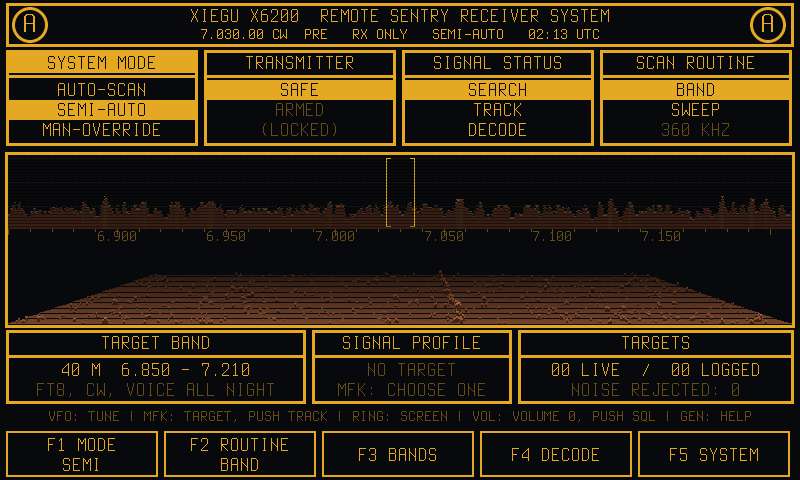

*A SCAN, the screen the radio starts in: the base's 384 kHz around the dial as a trace over a 3D picture of the last
seconds, where the signals over the noise are marked and named. Here the 60 m band at 2:39 at night, with nothing
over the noise.*

[What it adds](#what-it-adds) · [Screenshots](#screenshots) · [Install](#install) · [Hardware](#hardware) ·
[Manual](docs/MANUAL.md#the-sentry) · [Upstream's README](README_original.md)

Developed and tested on an X6200. The image for the X6100 builds from the same source, but nobody has tried it here.

## What it adds

### The Sentry

The X6200's home screen: the radio starts in it, and every app or menu opened from it comes back to it when it
closes. **Transmit is locked while it is open**: PTT, KEY, MSG and the antenna tuner are refused. Six screens,
turned with the MFK's inner ring:

- **A SCAN**: the base's 384 kHz around the dial, the signals in it found, marked and labelled. AUTO-SCAN goes
  from one to the next by itself, SEMI-AUTO lets the MFK choose, MAN-OVERRIDE is the VFO knob's. BAND stays on one
  band; SWEEP goes through the bands marked for it.
- **B TRACK**: one signal held: what it is, how long it has been on, its level over the noise. Record it, hold it
  or ignore it.
- **C BANDS**: what each band carries, when it is open and what antenna it wants, with what the Sentry last heard
  there.
- **D DECODE**: the decoders and the frequencies they work on, each a key away.
- **E SYSTEM**: the rest of the radio in the same look: Settings, the apps, the digital modes, AIRSPACE,
  VHF/UHF, the classic radio screen, a UNIX shell on the radio's own screen, and which screen the radio starts in.
- **F VHF/UHF**: the RTL-SDR (next section).

GEN shows the controls on every screen. The Sentry's look is also a theme for the whole radio: Settings, the
on-screen keyboard, the apps and their tables all draw in amber.

### F VHF/UHF: an RTL-SDR as a second receiver

A generic RTL-SDR stick (an RTL2832U with an R820T, R828D or the like) on the HOST port:

- **The spectrum**: the middle 1.8 MHz of the stick's span as a trace over a 3D waterfall, like A SCAN's. The
  strongest signals are labelled with what they are where it is known: NOAA WX1 to WX7, AIS, APRS, the ISS,
  marine channel 16, guard 121.500, the airband, weather balloons, the Meteor-M satellites, ISM, GMRS, UAT, ADS-B.
  FM broadcast stations are labelled on their channel (97.900).
- **F2 PRESET**: NOAA weather, 2 m, 2 m repeaters, the airband, FM broadcast, marine VHF, the weather satellites,
  the weather balloons, 70 cm, ISM 433, GMRS, ISM 915, UAT 978 and ADS-B 1090. **F3 STEP** sets how far the MFK
  pans (12.5 kHz to 1 MHz); the MFK's push sets the gain.
- **F4 VIEW**: RTL (the stick alone), SPLIT (the X6200's own spectrum above, the stick below) or X6200 (the radio
  alone). The stick keeps running in all three.
- **F5 LISTEN** puts the stick on the speaker in place of the X6200, or gives the speaker back. A tap on a signal
  listens to that one. The mode follows the band: wide FM on 87.5-108 MHz, AM on the airband, narrow FM elsewhere.
  While the stick is heard the **VFO knob tunes it**, a channel a click, and the header shows its frequency
  (`RTL 162.550.00 NFM`).
- The speaker plays one receiver or the other, never both: the X6200's base gives it either the radio's receiver or
  the GUI's audio.
- A small helper program, `x6x00-rtlspec` ([tools/rtlspec](tools/rtlspec/rtlspec.c)), reads the stick and
  demodulates it, so a stick that hangs or is pulled out never takes the screen with it. A stick that opens but
  sends nothing is said on the screen: unplug it and plug it in again.

### NOAA Weather Radio alerts

While F has the stick and a NOAA Weather Radio channel is in view, the strongest one is watched for **SAME** headers,
the data bursts the National Weather Service sends before every alert and test, whether you are listening to it
or not. An alert takes the title of every Sentry screen, blinking, for its duration: `WX ALERT: TORNADO WARNING`,
with the issuing office, the number of areas and the duration in a message. Each one is kept in
`/mnt/wx_alerts.log`. The decoder ([tools/rtlspec/same.c](tools/rtlspec/same.c)) votes the header's three copies
character by character.

### AIRSPACE

ADS-B aircraft on a scope around you (a USB GPS, else your QTH locator, else the traffic itself), with their calls,
heights and tracks, and their history fading out. Its receiver on the HOST port: a GNS 5890, a microADSB, or an
RTL-SDR decoded by dump1090-fa, which is in the image. It lends the RTL-SDR to F VHF/UHF while that screen is open
and takes it back after. E SYSTEM > AIRSPACE, or APP > Airspace.

### Keyboard and mouse

- **Keyboard**: a Bluetooth or USB keyboard types into every text box. Its shortcuts (the knob keys, CapsLock
  chords) work only with Settings > Keys > KEYBOARD AND MOUSE > **Shortcuts** on. That is off by default, so a
  keyboard only types.
- **Mouse**: a USB or Bluetooth mouse, or a keyboard's touchpad, points and clicks on every screen with
  **Mouse** on. The wheel turns the MFK, the right button is ESC, and the pointer hides after a few seconds still.

### Boot video

Put your own video at `/mnt/bootvideo.mp4` and it plays from the first seconds of the boot in place of the boot
logo; the GUI comes up when it ends (30 s at most). [tools/bootvideo/prepare.sh](tools/bootvideo/prepare.sh) fits
any video to the screen. A small decode-only ffmpeg is in the image for it. The kernel draws no logo of its own
before it (the build trees' kernels carried Aether Radio's wolf), so the screen stays dark until the video starts.
[Manual](docs/MANUAL.md#boot-video).

### The base firmware, updated from OpenX6X00

The X6200's base, the radio board's own firmware from Xiegu, written from OpenX6X00 over SSH, without Xiegu's own
system and its card swaps: [tools/base_update](tools/base_update/README.md). fetch.sh downloads Xiegu's 1.0.8
update and takes the base's file out of it; flash.sh writes it with **base_flash**, which does on the radio what
Xiegu's app 1.0.8 does from its UPGRADE screen, step for step, its timeouts and error handling worked out from that
app's code. `flash.sh --check` reads the base's version and touches nothing. Base 1.0.8 fixes the S-meter stuck at
S1, -121.0 on 1.0.7; this fork's X6200 went from 1.0.7 to 1.0.8 this way on 13 November 2026.
[More](#the-baseband).

### Smaller things

- The clock in your own time zone (Settings > General > Date / Time), on the main screen, the Sentry and
  AIRSPACE.
- The processor's temperature wherever the battery and the time are: under the main screen's clock (every theme;
  on Ops Room's clock between the supply and the charge), on Walkie after the battery's voltage, and on Amber Trey's
  status line after the time and the voltage.
- The RTTY tile in Digital modes shows your baud rate.

### Decoder fixes

Found with recordings played into the radio and test signals from a HackRF on the bench:

- **CW**: a strong station decodes; weak ones decode again (the noise floor follows the gaps up as fast as down);
  the decoder no longer goes deaf for good after digital silence.
- **FT8, FT4, FT2**: each audio block goes to the slot it came in during, so FT2 decodes; contest exchanges are
  shown as WSJT-X shows them; a Fox's multi-stream message is rebuilt correctly for a Hound. A received free-text
  frame that ended the GUI was fixed and taken upstream
  ([Guru-RF/OpenX6X00#253](https://github.com/Guru-RF/OpenX6X00/pull/253)).
- **Olivia and Contestia**: a signal that starts after noise decodes, and so does a clean one.
- **NAVTEX**: weak and fading signals read from both copies together; each transmission read five ways, the best
  shown.
- **SSTV**: PD90, PD120 and PD180 received (the ISS sends PD120), and every mode's picture on its own pixels and
  rows (it used to sit 2-4 pixels right, and some modes a row or two low).

### Tools

- [tools/cross_x6200](tools/cross_x6200/setup.sh): the X6200 GUI built on a Mac, no Docker or buildroot tree,
  and put on the radio over SSH in seconds.
- [tools/replay](tools/replay/replay.sh): a recording heard by the radio's own apps as if its receiver heard
  it, to test a decoder against real signals.
- [tools/rtlsdr](tools/rtlsdr/build.sh) and [tools/bootvideo](tools/bootvideo/build.sh): the RTL-SDR programs
  and ffmpeg built for a radio running an older image.
- [tools/base_update](tools/base_update/README.md): the X6200's base firmware fetched from Xiegu and written from
  OpenX6X00, with its tests (a simulated base).
- [tools/adsb](tools/adsb/adsb_read.py), [tools/ft8_live](tools/ft8_live), [tools/js8_play](tools/js8_play),
  [tools/cw_trainer](tools/cw_trainer): ADS-B sticks read on the radio, FT8 decodes watched live, JS8 played
  in, CW test messages.
- [radio_captures](radio_captures): what the radio heard while the decoders were tested and fixed.

## Screenshots

Taken on 12 and 13 November 2026 on an X6200 (base 1.0.7) in Dublin, Ohio, on its own antenna and a generic
RTL-SDR (R820T) with its stock whip. NOAA Weather Radio on 162.550 MHz and WNCI 97.9 FM are real signals; the
aircraft on AIRSPACE were heard by a GNS 5890. The Wi-Fi network's name, the addresses and the Bluetooth
adapter's address are blanked out. The S-meter's S1 and -121.0 are the 1.0.7 base's fault
([The baseband](#the-baseband)).

**The Sentry**

| | |
|---|---|
|  **A SCAN**: the screen the radio starts in | 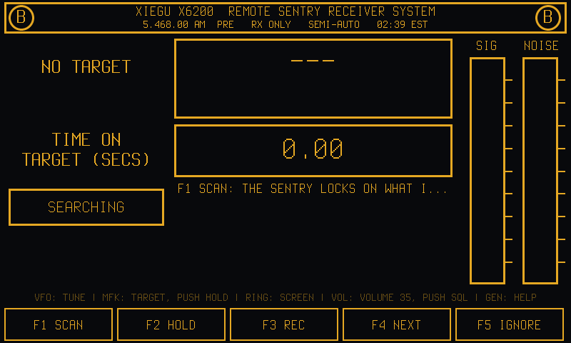 **B TRACK**: one signal held |
| 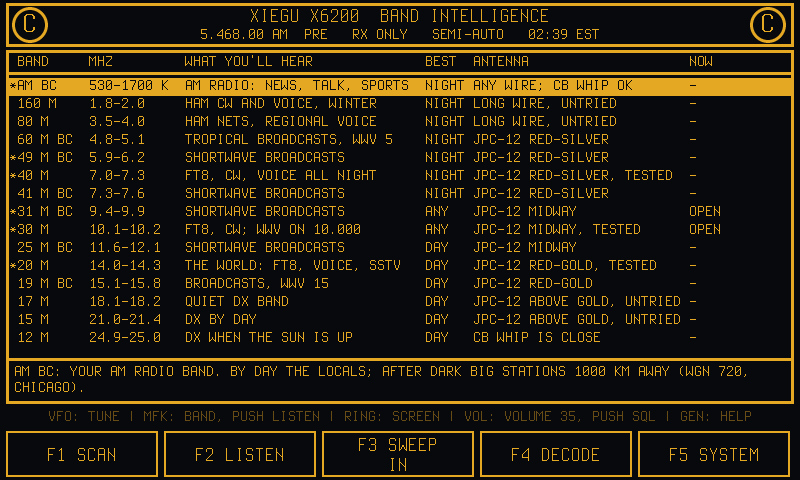 **C BANDS**: what each band carries and when | 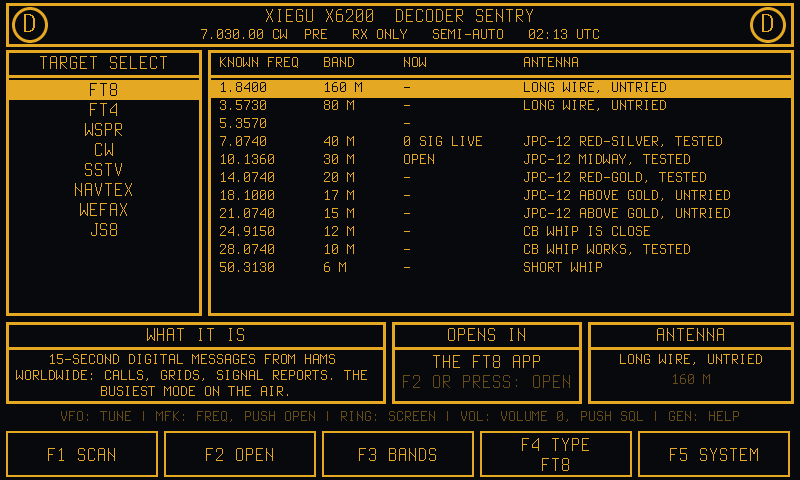 **D DECODE**: the decoders and their frequencies |
| 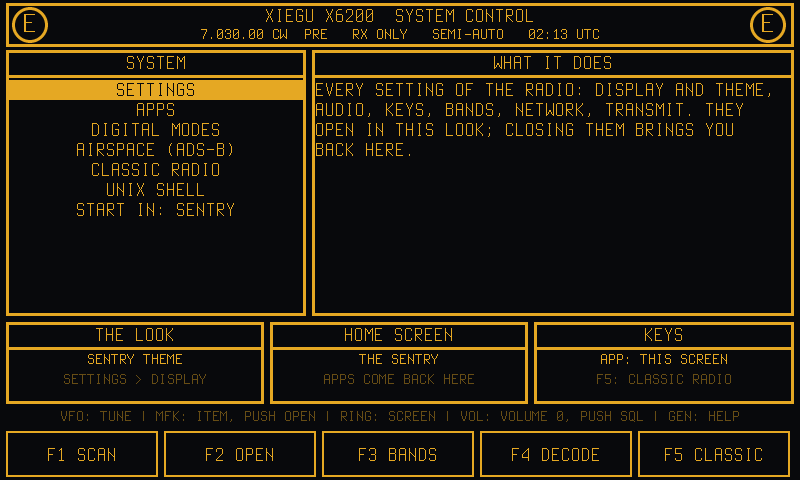 **E SYSTEM**: the rest of the radio | 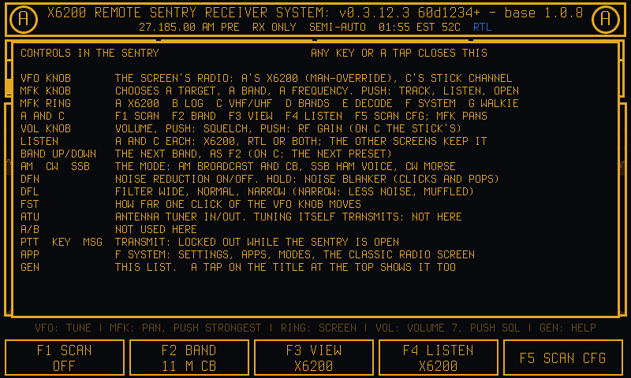 **GEN**: the controls |

**F VHF/UHF, an RTL-SDR on the HOST port**

| | |
|---|---|
| 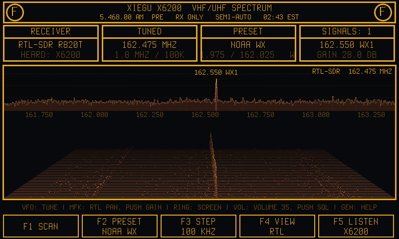 **View RTL**: NOAA Weather Radio, WX1 on 162.550 | 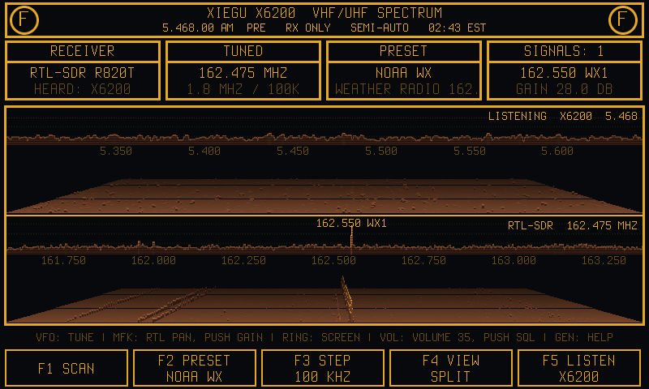 **View SPLIT**: the X6200's 60 m above, the stick below |
| 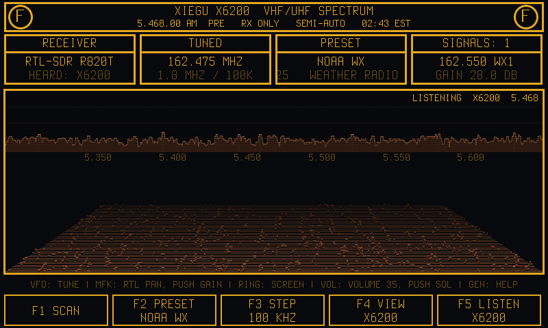 **View X6200**: the radio's own spectrum alone | 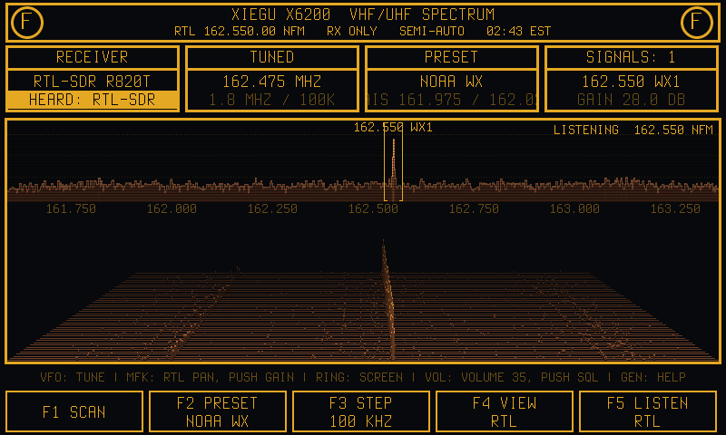 **F5 LISTEN**: WX1 on the speaker, the header follows it |
| 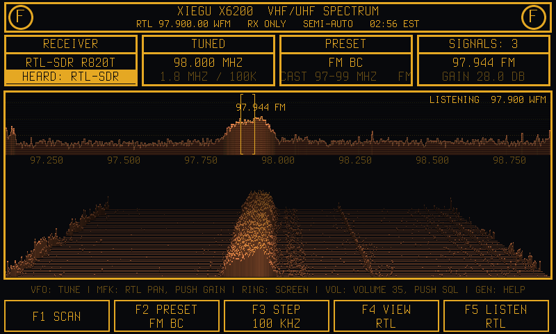 **FM broadcast**: WNCI 97.9 in wide FM | 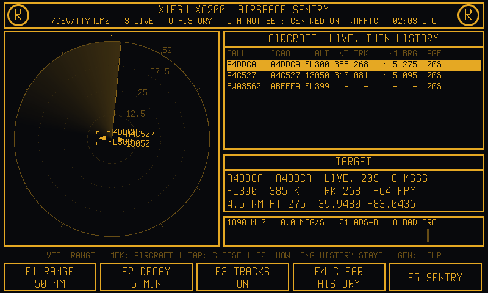 **AIRSPACE**: ADS-B from a GNS 5890, a microADSB or an RTL-SDR |

**Settings, in the same look: every tab**

| | |
|---|---|
| 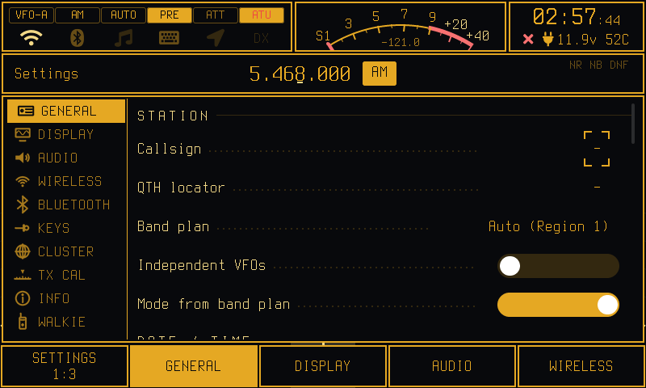 **General**: station, band plan, date and time zone | 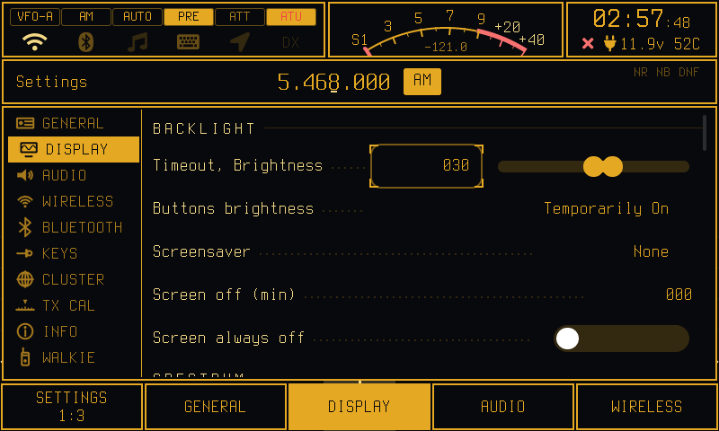 **Display**: backlight, screensaver, the spectrum |
| 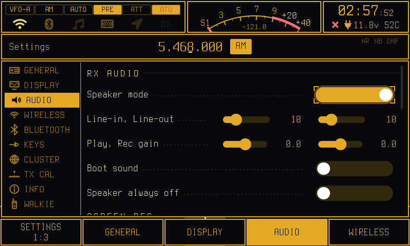 **Audio** | 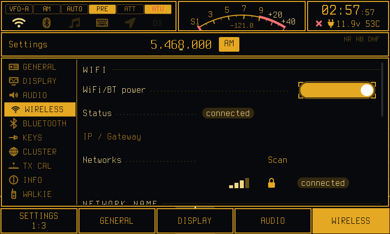 **Wireless** |
| 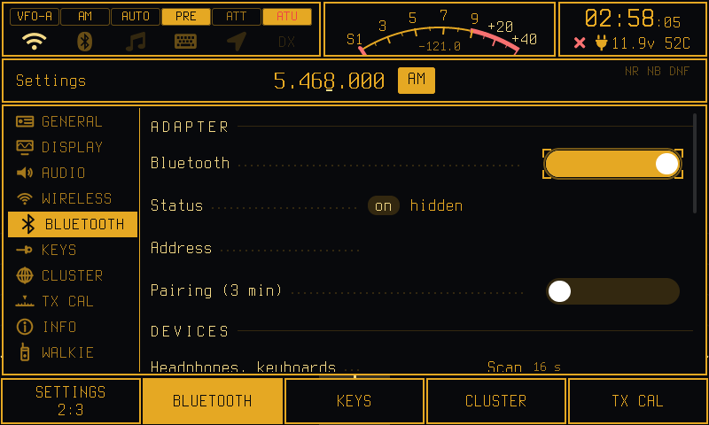 **Bluetooth**: pairing, headphones and keyboards | 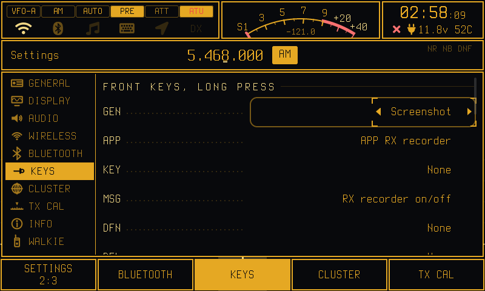 **Keys**: long presses, the hand mic, the paddle |
| 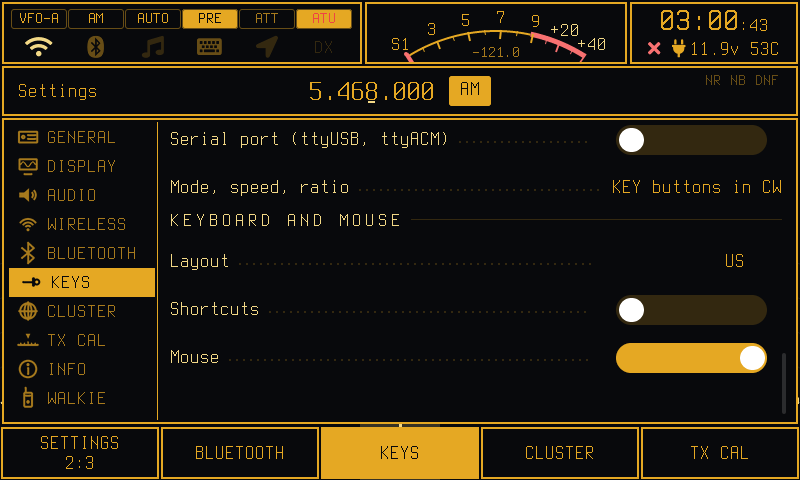 **Keys > KEYBOARD AND MOUSE**: layout, Shortcuts, Mouse | 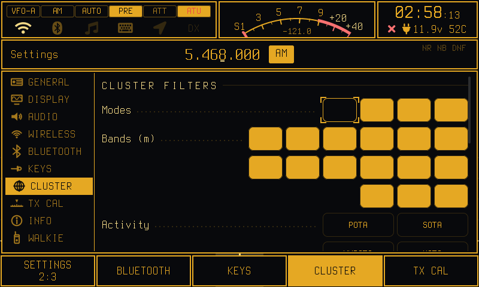 **Cluster** |
| 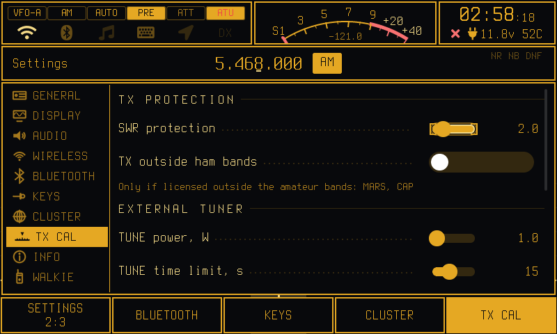 **TX Cal** | 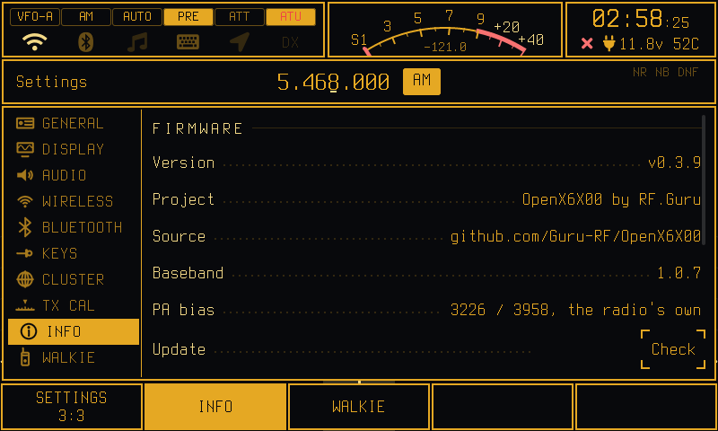 **Info**: versions, the PA bias, Update |
| 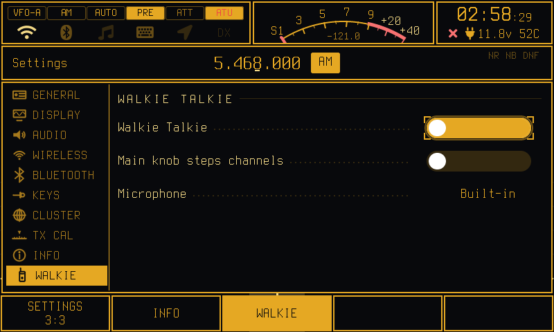 **Walkie** | |

**Apps and the classic screen**

| | |
|---|---|
| 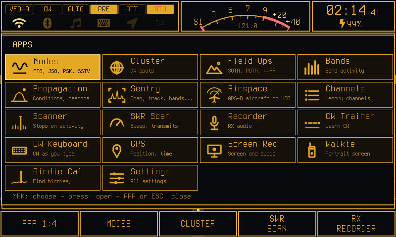 **APP**: every app, the Sentry and Airspace among them | 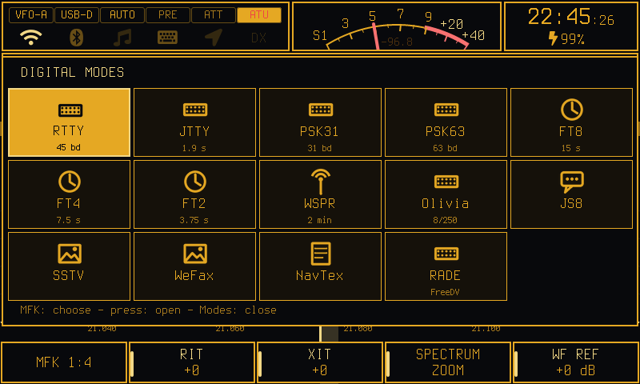 **Digital modes** |
| 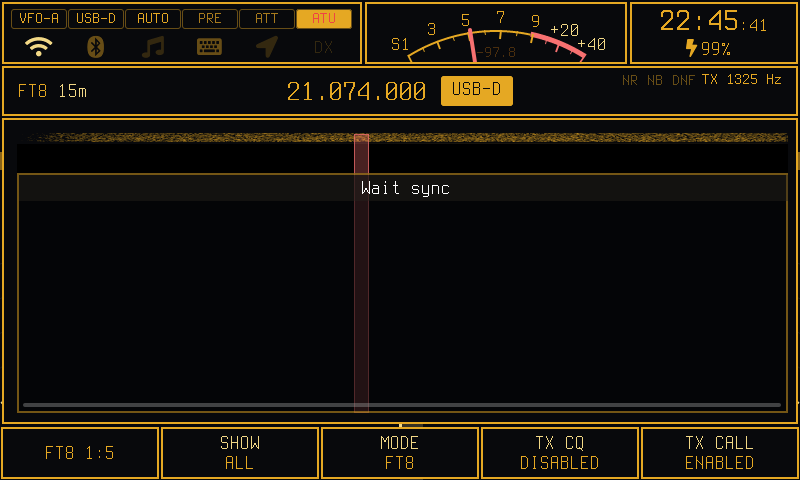 **FT8** | 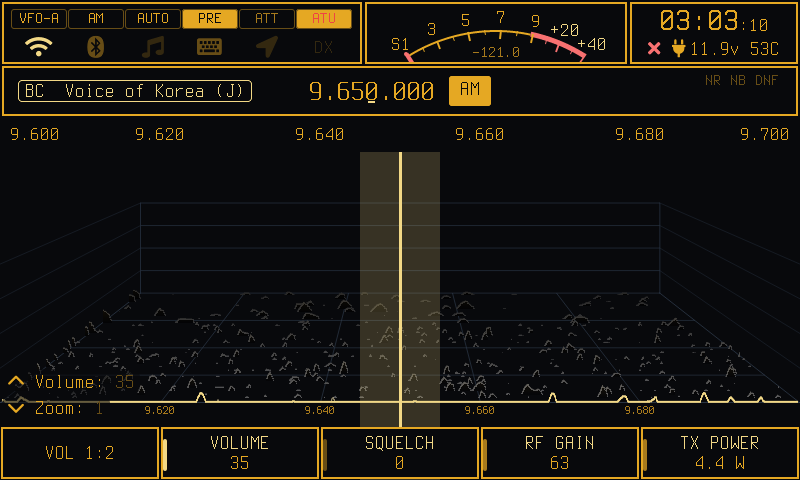 **Classic radio**: the clock and the temperature at the top right |

**Where the look comes from.** The remote sentry guns of James Cameron's *Aliens* (1986, 20th Century Fox) and
their amber-on-black screens, as in this clip, "Aliens 1986 Turrets" (Mic Mitja, YouTube):

[](https://www.youtube.com/watch?v=IS2PtmM9mwU)

## Install

1. **The card image.** GitHub builds both radios' images on every push to `main`. Open
   [Actions > Build image](https://github.com/MAVProxyUser/X6200-claude-assist-UI/actions/workflows/main.yml),
   the latest green run, and download the X6200's image from its Artifacts (you need to be signed in to GitHub;
   artifacts are kept 30 days).
2. **Write it to a microSD card** with [balenaEtcher](https://etcher.balena.io/) and start the radio from it, as
   upstream describes ([README_original.md, Install](README_original.md#install)). Settings and logs live on the
   card's DATA partition (`/mnt`).

**Settings > Info > Update installs this fork's releases**, from the GitHub repository the image was built from:
this one for its own images, and a fork's own for a fork's images (the build writes the repository into the image,
`/usr/share/x6100/update-repo`). A release is made by pushing a version tag (`v0.3.9.1`, the version in `src/main.h`);
GitHub builds both radios' images and bundles and attaches them. Nothing is signed and there is no key to keep, for
this repository or a fork of it: a download rests on HTTPS to GitHub, and each file is checked against the bundle's
own list of SHA-256 sums. RF.Guru's releases are not this updater's business: their GUI would drop everything above.
A radio still on an older card image has RF.Guru's updater, which asks RF.Guru's releases and wants their signature:
write this fork's card image once, or `touch /mnt/update/allow-unsigned` over SSH and give the web Update page this
fork's bundle file once. After that it updates from this fork by itself.

**Just the GUI, from a Mac**, onto a radio already running this fork's image (it reaches the radio over SSH):

```bash
tools/cross_x6200/setup.sh root@<radio>
```

```bash
tools/cross_x6200/build.sh && tools/cross_x6200/install.sh root@<radio>
```

`setup.sh` runs once (again after the radio's image changes). The radio's first GUI is kept as
`/usr/sbin/x6100_gui.orig`.

**A radio on an older image** gets the RTL-SDR programs and the boot video's ffmpeg with
`tools/rtlsdr/install.sh` and `tools/bootvideo/install.sh` (after their `build.sh`).

## Hardware

- **RTL-SDR**: any RTL2832U stick with an R820T or R828D tuner (the RTL-SDR Blog V3 and V4, the generic blue ones),
  on the HOST port. A short whip works for NOAA and FM broadcast; ADS-B wants a 1090 MHz antenna.
- **ADS-B**: a GNS 5890, a microADSB, or an RTL-SDR.
- **Keyboard and mouse**: Bluetooth (paired in Settings > Bluetooth) or USB on the HOST port.

## The baseband

The radio board's own firmware, from Xiegu: upstream's README has the table of bases and Xiegu's way to update one
([README_original.md, The baseband](README_original.md#the-baseband)). On the X6200's base 1.0.7 the S-meter can
stick at S1, -121.0; 1.0.8 fixes it, and also corrects the CW keyer's speed and brings back its macros.

This fork updates the X6200's base from OpenX6X00 as well ([tools/base_update](tools/base_update/README.md),
[manual](docs/MANUAL.md#the-x6200s-base-firmware-from-openx6x00)):

```bash
tools/base_update/fetch.sh && tools/base_update/build.sh
```

```bash
tools/base_update/flash.sh root@<radio> --check
```

```bash
tools/base_update/flash.sh root@<radio> --flash
```

`--check` only reads. `--flash` stops the GUI, writes the base in about half a minute and starts the GUI again;
the radio then switches itself off, and is switched on again by hand to run the new firmware. As Xiegu asks: a
13.8 V supply of 3 A or more and the battery out while it writes. A write that fails after the erase is written
again with `--recover`; `--to 1.0.7` goes back.

## Documentation

- [The manual](docs/MANUAL.md): [the Sentry](docs/MANUAL.md#the-sentry),
  [F VHF/UHF](docs/MANUAL.md#f-vhfuhf-an-rtl-sdr), [AIRSPACE](docs/MANUAL.md#airspace),
  [the mouse](docs/MANUAL.md#mouse), [the boot video](docs/MANUAL.md#boot-video), and everything upstream does.
- [Upstream's README](README_original.md): the full feature list, reporting a problem, updating, Tailscale,
  building the image, the source's layout.

## Credits and licences

This fork stands entirely on [OpenX6X00](https://github.com/Guru-RF/OpenX6X00) by Joeri Van Dooren ON6URE
(RF.Guru), and through it on the R1CBU GUI by Oleg Belousov R1CBU and Georgy Dyuldin R2RFE and the work of everyone
credited in [README_original.md](README_original.md#credits). Support upstream:
[Buy me a coffee](https://buymeacoffee.com/on6ure).

The licences are upstream's ([README_original.md, Licences](README_original.md#licences)): the GUI is
LGPL-2.1-or-later, the image as a whole GPLv3. This fork's additions to the GUI and `x6x00-rtlspec` are
LGPL-2.1-or-later; the image also carries dump1090-fa and RTL-SDR Blog's librtlsdr (both GPL-2.0-or-later) and a
cut-down ffmpeg (LGPL-2.1-or-later).
