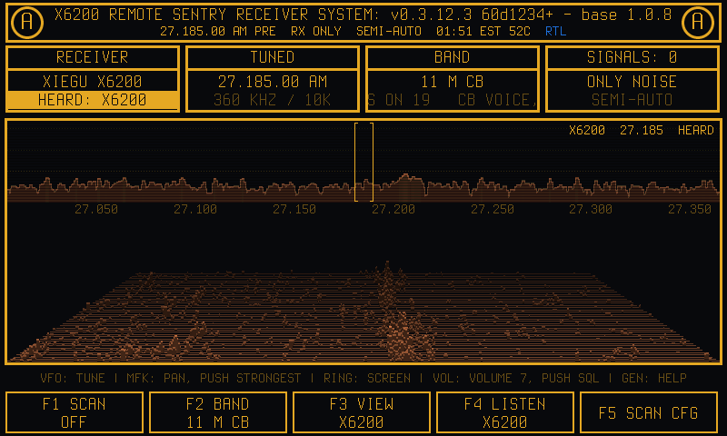
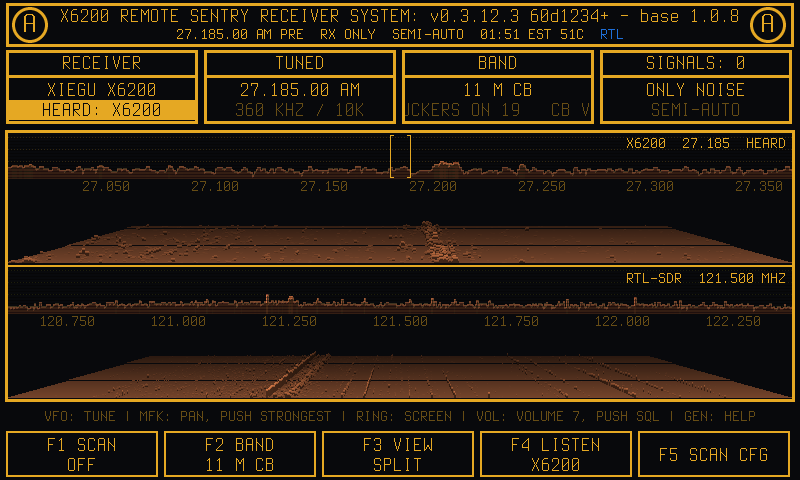
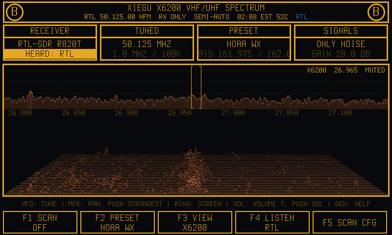
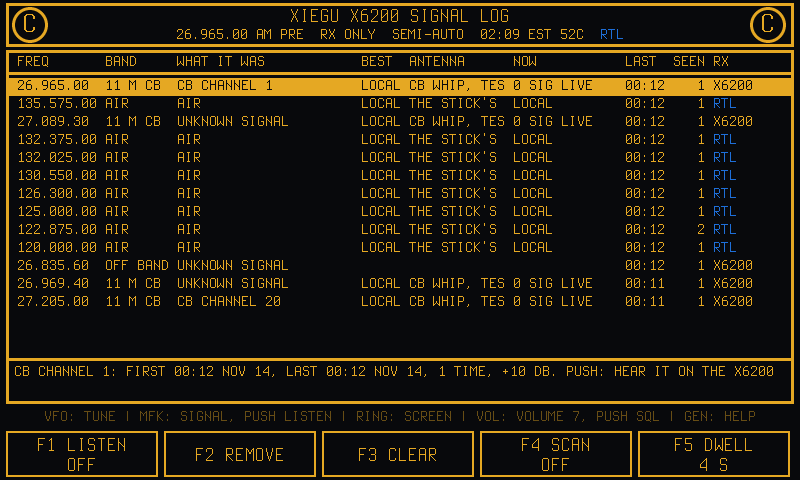
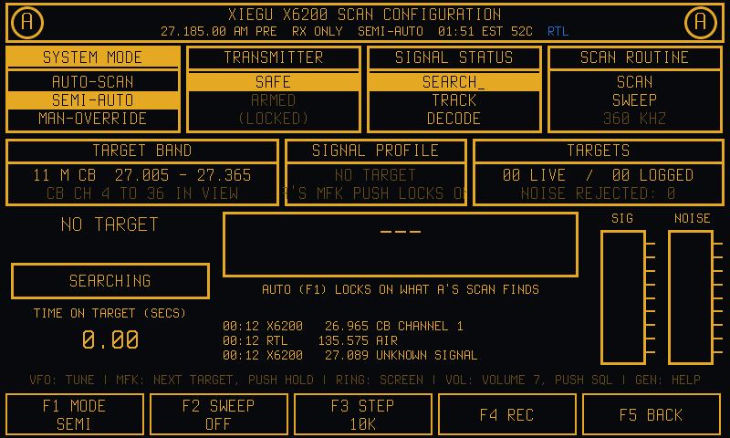
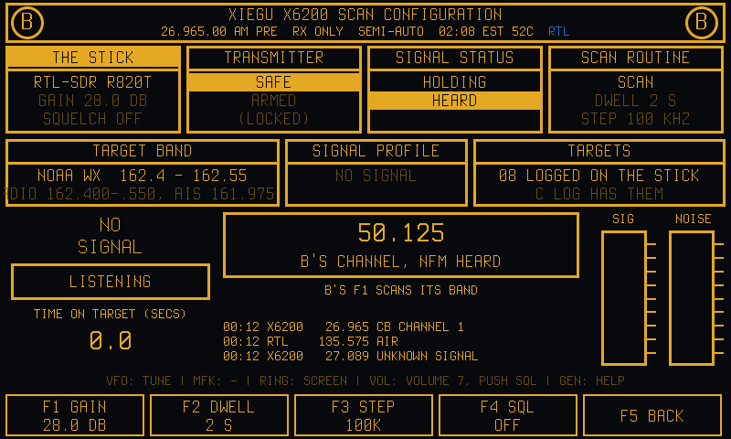
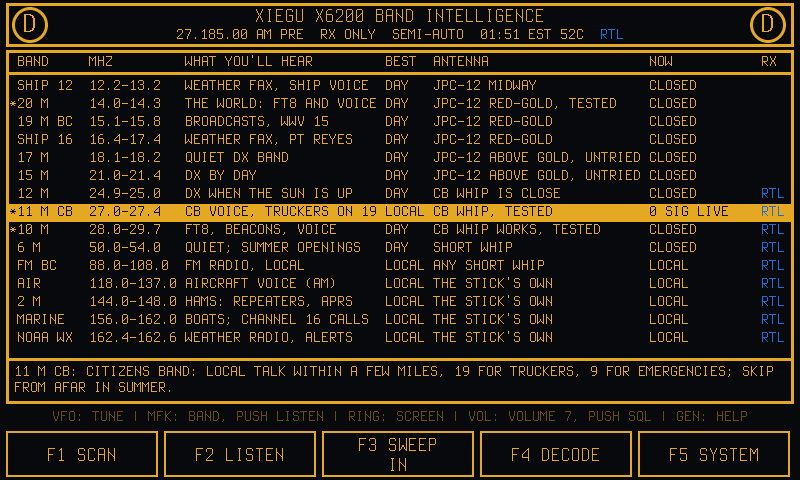
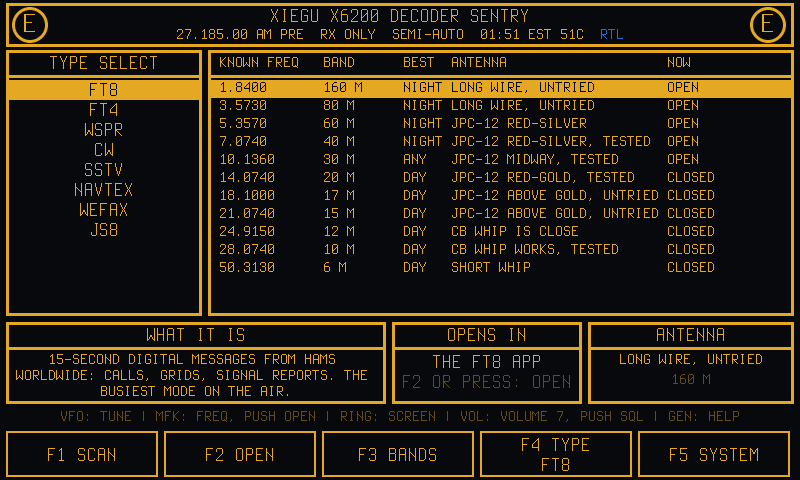
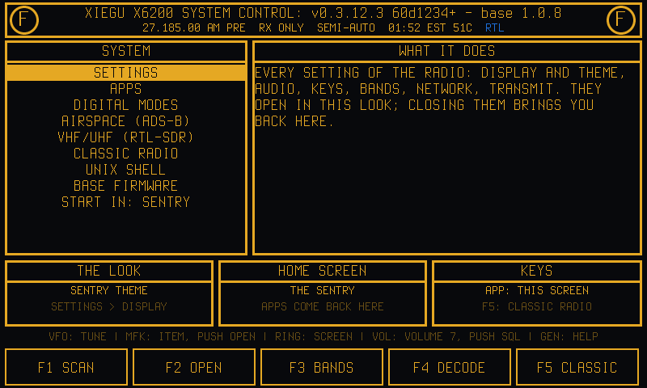
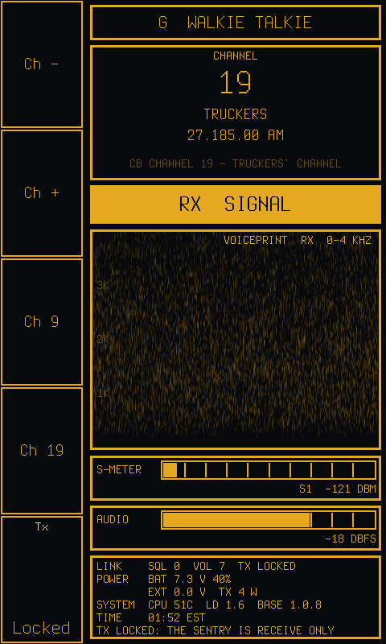

# X6200 Claude Assist UI

A fork of [OpenX6X00 by RF.Guru](https://github.com/Guru-RF/OpenX6X00), the open firmware for the Xiegu X6100 and
X6200, built around listening. It adds the **Sentry**, a receive-first home screen in amber on black, and a second
receiver: an RTL-SDR stick on the HOST port, 24 MHz to 1.7 GHz, with its spectrum next to the X6200's and its
audio on the speaker. NOAA Weather Radio alerts, ADS-B aircraft, a keyboard and a mouse, a boot video and a list
of decoder fixes come with it.

Everything upstream does is still here: the digital modes, the cluster, the portable tiles, the browser remote,
TCI, the web configurator. Upstream's own README, with its feature list, install and build instructions and credits,
is kept as **[README_original.md](README_original.md)**.



*A, the screen the radio starts in: the X6200's 360 kHz around the dial as a trace over a 3D picture of the last
seconds, the dial bracketed and the signals over the noise named, the RTL-SDR's twin screen's keys along the bottom.
Here 11 m CB, channel 19.*

[What it adds](#what-it-adds) · [Screenshots](#screenshots) · [Install](#install) · [Hardware](#hardware) ·
[Manual](docs/MANUAL.md#the-sentry) · [Upstream's README](README_original.md)

Developed and tested on an X6200. The image for the X6100 builds from the same source, but nobody has tried it here.

## What it adds

### The Sentry

The X6200's home screen: the radio starts in it, and every app or menu opened from it comes back to it when it
closes. **Transmit is locked while it is open**: PTT, KEY, MSG and the antenna tuner are refused; on A and G the
**A/B key arms the transmitter for PTT** until A/B again or another screen. Seven screens,
turned with the MFK's inner ring, AIRSPACE as an eighth (H, between G and A), and SCAN CFG beside the two spectrum
screens:

- **A X6200** and **B VHF/UHF**: the X6200's spectrum and an RTL-SDR's, one screen set up for each radio: the same
  four boxes (RECEIVER, TUNED, BAND or PRESET, SIGNALS), the same trace over a 3D picture with the signals named
  and the screen's channel bracketed, the same keys. **F1 SCAN** sweeps the band end to end, locking on what it
  finds (into C LOG); **F2** chooses the band (A) or preset (B); **F3 VIEW** shows the radio alone, SPLIT with the
  other, or the other alone; **F4 LISTEN** is each screen's own: the X6200, the RTL-SDR, BOTH mixed or OFF;
  **F5 SCAN CFG**. The MFK pans, its push goes to the strongest signal; the VFO tunes the screen's own radio.
- **C LOG**: every signal the two scans locked on, newest first, with D's columns (BAND, BEST, ANTENNA, NOW), when it
  was last heard and how often, and which radio heard it. The MFK goes through them and each plays on its own radio,
  switching between the two by itself; **F4 SCAN** goes through the list by itself, holding on whatever is busy.
- **D BANDS**: what each band carries, when it is open and what antenna it wants, with what the Sentry last heard
  there. The airband, 2 m, marine VHF, NOAA weather, 70 cm and GMRS are in it too; its **RX** column names the radio
  that takes each band: X6200, or RTL (in the spectrum's orange) for the stick's, and LISTEN opens those on B. **F1 SCAN** sets the band chosen on its
  radio and scans it end to end (A for the X6200's, B for the stick's).
- **E DECODE**: the decoders and the frequencies they work on, each a key away, and the radio each is heard on.
- **F SYSTEM**: the rest of the radio in the same look: Settings, the apps, the digital modes, AIRSPACE,
  VHF/UHF, the classic radio screen, a UNIX shell on the radio's own screen, the base firmware, and which screen the
  radio starts in. The title says the release, the GUI's commit and the base's version; A's says what its scope
  takes in (`MF/HF/VHF SPECTRUM`).
- **G WALKIE**, held up (portrait): a walkie-talkie across both radios: CB, 10 m and 6 m FM on the X6200, MURS,
  2 m, marine, NOAA weather and FRS/GMRS on the stick, CH-/CH+ going from one radio to the other by itself and the
  screen saying which (VIA X6200, VIA RTL-SDR); GROUP, MODE (AM, FM, SSB; a table, more to come), a **voiceprint**
  of what is heard (a 0-4 kHz sonogram scrolling across), the S-meter and the audio's level, the battery, the
  processor's temperature. A/B arms PTT on the X6200's channels.
- **SCAN CFG** (F5 on A or B, on no ring): A's scan settings and its lock: AUTO-SCAN or SEMI-AUTO (MAN-OVERRIDE
  comes by itself when the VFO is turned), SWEEP through the marked bands, STEP, and the signal locked on (HOLD,
  NEXT, REC, IGNORE); from B, the stick's GAIN, DWELL, STEP and SQUELCH.

The title bar shows what is plugged in, in the orange of the spectrum's peaks: **RTL**, **ADS-B**, **WR12**, and after
the processor's temperature the battery's charge with a bolt while it charges, yellow from 30%, orange at 20% and red
from 15% down. GEN shows the controls on
every screen. The Sentry's look is also a theme for the whole radio: Settings, the
on-screen keyboard, the apps and their tables all draw in amber.

### B VHF/UHF: an RTL-SDR as a second receiver

A generic RTL-SDR stick (an RTL2832U with an R820T, R828D or the like) on the HOST port:

- **The spectrum**: the middle 1.8 MHz of the stick's span. The strongest signals are labelled with what they are
  where it is known: NOAA WX1 to WX7, AIS, APRS, the ISS, marine channel 16, guard 121.500, the airband, weather
  balloons, the Meteor-M satellites, ISM, GMRS, UAT, ADS-B; FM broadcast stations on their channel (97.900).
- **F2 PRESET**: NOAA weather, 2 m, 2 m repeaters, the airband, FM broadcast, marine VHF, the weather satellites,
  the weather balloons, 70 cm, ISM 433, GMRS, ISM 915, UAT 978 and ADS-B 1090 (or the band D's LISTEN brought).
  Its scan goes on behind the other screens.
- **LISTEN BOTH** mixes the X6200's receiver into the stick's audio: the two on the speaker at once; OFF silences
  both. The speaker changes only when A or B is shown; the other screens keep what was heard last. **Each radio
  keeps its own volume** (the VOL knob on A and on B), played at it wherever that radio is heard.
- **The VOL/SQL/RFG knob** on B: its squelch and RF gain are the stick's. Squelch in dB over the noise (OFF, 1 to
  40): SQUELCHED on the stick's half while it is shut.
- B stays as it was left: the band, the tuning, the channel and the scan come back with it.
- **The stick is opened once and never closed while it is plugged in**: a daemon, `x6x00-rtlspec`
  ([tools/rtlspec](tools/rtlspec/rtlspec.c)), holds it and keeps it streaming for as long as the radio runs, and
  hands the screens only what they ask for (the spectrum, a channel's audio, weather alerts). Screens, apps, a GUI
  restarted or updated and AIRSPACE (its dump1090 reads the daemon's samples) all leave the stick alone; stopping and
  starting its stream is what can leave this radio's USB host sending nothing. An RTL-SDR, a GNS 5890 and a
  microADSB can be swapped while the radio runs; a stick that sends nothing is left alone until it is plugged in
  again. The daemon is a program of its own, so a stick that hangs or is pulled out never takes the screen with it.

### NOAA Weather Radio alerts

While a NOAA Weather Radio channel is in the stick's view, the strongest one is watched for **SAME** headers,
the data bursts the National Weather Service sends before every alert and test, whether you are listening to it
or not. An alert takes the title of every Sentry screen, blinking, for its duration: `WX ALERT: TORNADO WARNING`,
with the issuing office, the number of areas and the duration in a message. Each one is kept in
`/mnt/wx_alerts.log`. The decoder ([tools/rtlspec/same.c](tools/rtlspec/same.c)) votes the header's three copies
character by character.

### AIRSPACE

ADS-B aircraft on a scope around you (a USB GPS, else your QTH locator, else the traffic itself), with their calls,
heights and tracks, and their history fading out. Its receiver on the HOST port: a GNS 5890, a microADSB, or an
RTL-SDR decoded by dump1090-fa, which is in the image. An RTL-SDR is AIRSPACE's while its screen is open and the
Sentry's the rest of the time. The Sentry's ring past G (it is H), F SYSTEM > AIRSPACE, or APP > Airspace; and by
itself when a GNS 5890 or a microADSB becomes the only ADS-B receiver on USB, the RTL-SDR swapped out for it.

### Keyboard and mouse

- **Keyboard**: a Bluetooth or USB keyboard types into every text box. Its shortcuts (the knob keys, CapsLock
  chords) work only with Settings > Keys > KEYBOARD AND MOUSE > **Shortcuts** on. That is off by default, so a
  keyboard only types.
- **Mouse**: a USB or Bluetooth mouse, or a keyboard's touchpad, points and clicks on every screen with
  **Mouse** on. The wheel turns the MFK, the right button is ESC, and the pointer hides after a few seconds still.

### Boot video

The image plays its own start-up video (GoldCorp, 15 s) from the first seconds of the boot in place of the boot
logo; put your own at `/mnt/bootvideo.mp4` and it plays instead. The GUI comes up when it ends (30 s at most). [tools/bootvideo/prepare.sh](tools/bootvideo/prepare.sh) fits
any video to the screen. A small decode-only ffmpeg is in the image for it. The kernel draws no logo of its own
before it (the build trees' kernels carried Aether Radio's wolf), nor does the X6200's U-Boot (its submarine, top
right), so the screen stays dark until the video starts.
[Manual](docs/MANUAL.md#boot-video).

### The base firmware, updated from OpenX6X00

The X6200's base, the radio board's own firmware from Xiegu, fetched and written from OpenX6X00, without Xiegu's
own system and its card swaps: [tools/base_update](tools/base_update/README.md).

- **On the radio**: F SYSTEM > BASE FIRMWARE lists every release Xiegu has published (1.0.3, 1.0.6, 1.0.7, 1.0.8),
  fetches the one chosen from xiegu.eu (Xiegu's 370 MB update streamed, only the base file kept, checked by its
  SHA-256) and writes it, showing the writer's steps, the kernel's messages and the base's serial port as they come,
  and when the base is done.
- **Once a day**, online, the radio looks at xiegu.eu's downloads page and says when there is a newer base. It never
  downloads or writes one by itself.
- **The writer**, x6x00-base-flash, does what Xiegu's app 1.0.8 does from its UPGRADE screen, step for step, its
  timeouts and error handling worked out from that app's code, and is tested against a simulated base in every way
  it can fail. The same from a computer: fetch.sh, flash.sh.

Base 1.0.8 fixes the S-meter stuck at S1, -121.0 on 1.0.7. On 13 November 2026 this fork's X6200 went from 1.0.7 to
1.0.8, back to 1.0.7 (a downgrade works), and to 1.0.8 again from its own screen. [More](#the-baseband).

### Smaller things

- The clock in your own time zone (Settings > General > Date / Time), on the main screen, the Sentry and
  AIRSPACE.
- The processor's temperature wherever the battery and the time are: under the main screen's clock (every theme;
  on Ops Room's clock between the supply and the charge), on Walkie after the battery's voltage, on Amber Trey's
  status line after the time and the voltage, and in the Sentry's title bar after the time.
- The RTTY tile in Digital modes shows your baud rate.

### Decoder fixes

Found with recordings played into the radio and test signals from a HackRF on the bench:

- **CW**: a strong station decodes; weak ones decode again (the noise floor follows the gaps up as fast as down);
  the decoder no longer goes deaf for good after digital silence.
- **FT8, FT4, FT2**: each audio block goes to the slot it came in during, so FT2 decodes; contest exchanges are
  shown as WSJT-X shows them; a Fox's multi-stream message is rebuilt correctly for a Hound. A received free-text
  frame that ended the GUI was fixed and taken upstream
  ([Guru-RF/OpenX6X00#253](https://github.com/Guru-RF/OpenX6X00/pull/253)).
- **Olivia and Contestia**: a signal that starts after noise decodes, and so does a clean one.
- **NAVTEX**: weak and fading signals read from both copies together; each transmission read five ways, the best
  shown.
- **SSTV**: PD90, PD120 and PD180 received (the ISS sends PD120), and every mode's picture on its own pixels and
  rows (it used to sit 2-4 pixels right, and some modes a row or two low).

### Tools

- [tools/cross_x6200](tools/cross_x6200/setup.sh): the X6200 GUI built on a Mac, no Docker or buildroot tree,
  and put on the radio over SSH in seconds.
- [tools/replay](tools/replay/replay.sh): a recording heard by the radio's own apps as if its receiver heard
  it, to test a decoder against real signals.
- [tools/rtlsdr](tools/rtlsdr/build.sh) and [tools/bootvideo](tools/bootvideo/build.sh): the RTL-SDR programs
  and ffmpeg built for a radio running an older image.
- [tools/base_update](tools/base_update/README.md): the X6200's base firmware fetched from Xiegu and written from
  OpenX6X00, with its tests (a simulated base).
- [tools/adsb](tools/adsb/adsb_read.py), [tools/ft8_live](tools/ft8_live), [tools/js8_play](tools/js8_play),
  [tools/cw_trainer](tools/cw_trainer): ADS-B sticks read on the radio, FT8 decodes watched live, JS8 played
  in, CW test messages.
- [radio_captures](radio_captures): what the radio heard while the decoders were tested and fixed.

## Screenshots

Taken on 12 and 13 November 2026 on an X6200 (base 1.0.7) in Dublin, Ohio, on its own antenna and a generic
RTL-SDR (R820T) with its stock whip. NOAA Weather Radio on 162.550 MHz and WNCI 97.9 FM are real signals; the
aircraft on AIRSPACE were heard by a GNS 5890. The Wi-Fi network's name, the addresses and the Bluetooth
adapter's address are blanked out. The S-meter's S1 and -121.0 are the 1.0.7 base's fault
([The baseband](#the-baseband)).

**The Sentry**

| | |
|---|---|
|  **A X6200**: the screen the radio starts in |  **F3 VIEW SPLIT**: the X6200 above, the RTL-SDR below |
|  **B VHF/UHF**: the RTL-SDR's screen, set up as A is |  **C LOG**: what the scans locked on, each heard on its own radio |
|  **SCAN CFG** from A: the modes, the sweep, the lock |  **SCAN CFG** from B: the stick and its scan |
|  **D BANDS**: what each band carries; RX says which radio |  **E DECODE**: the decoders and their frequencies |
|  **F SYSTEM**: the rest of the radio |  **GEN**: the controls |
|  **G WALKIE**, held up: channel 19, the voiceprint, the meters |  **AIRSPACE**: ADS-B from a GNS 5890, a microADSB or an RTL-SDR |

**Settings, in the same look: every tab**

| | |
|---|---|
|  **General**: station, band plan, date and time zone |  **Display**: backlight, screensaver, the spectrum |
|  **Audio** |  **Wireless** |
|  **Bluetooth**: pairing, headphones and keyboards |  **Keys**: long presses, the hand mic, the paddle |
|  **Keys > KEYBOARD AND MOUSE**: layout, Shortcuts, Mouse |  **Cluster** |
|  **TX Cal** |  **Info**: versions, the PA bias, Update |
|  **Walkie** | |

**Apps and the classic screen**

| | |
|---|---|
|  **APP**: every app, the Sentry and Airspace among them |  **Digital modes** |
|  **FT8** |  **Classic radio**: the clock and the temperature at the top right |

**Where the look comes from.** The remote sentry guns of James Cameron's *Aliens* (1986, 20th Century Fox) and
their amber-on-black screens, as in this clip, "Aliens 1986 Turrets" (Mic Mitja, YouTube):

[](https://www.youtube.com/watch?v=IS2PtmM9mwU)

## Install

1. **The card image.** GitHub builds both radios' images on every push to `main`. Open
   [Actions > Build image](https://github.com/MAVProxyUser/X6200-claude-assist-UI/actions/workflows/main.yml),
   the latest green run, and download the X6200's image from its Artifacts (you need to be signed in to GitHub;
   artifacts are kept 30 days).
2. **Write it to a microSD card** with [balenaEtcher](https://etcher.balena.io/) and start the radio from it, as
   upstream describes ([README_original.md, Install](README_original.md#install)). Settings and logs live on the
   card's DATA partition (`/mnt`).

**A newer release asks to be applied by itself**: the daily check finds it, the radio fetches the bundle, and a box
over whatever is on the screen shows its version, the commit it was built from and the bundle's MD5: "Apply it?"
The MFK chooses Yes or No (No is chosen first) and its press confirms. No leaves it for Settings > Info > Update.

**Settings > Info > Update installs this fork's releases**, from the GitHub repository the image was built from:
this one for its own images, and a fork's own for a fork's images (the build writes the repository into the image,
`/usr/share/x6100/update-repo`). A release is made by pushing a version tag (`v0.3.9.2`, the version in `src/main.h`);
GitHub builds both radios' images and bundles and attaches them. Nothing is signed and there is no key to keep, for
this repository or a fork of it: a download rests on HTTPS to GitHub, and each file is checked against the bundle's
own list of SHA-256 sums. RF.Guru's releases are not this updater's business: their GUI would drop everything above.
A radio still on an older card image has RF.Guru's updater, which asks RF.Guru's releases and wants their signature:
write this fork's card image once, or `touch /mnt/update/allow-unsigned` over SSH and give the web Update page this
fork's bundle file once. After that it updates from this fork by itself.

**Just the GUI, from a Mac**, onto a radio already running this fork's image (it reaches the radio over SSH):

```bash
tools/cross_x6200/setup.sh root@<radio>
```

```bash
tools/cross_x6200/build.sh && tools/cross_x6200/install.sh root@<radio>
```

`setup.sh` runs once (again after the radio's image changes). The radio's first GUI is kept as
`/usr/sbin/x6100_gui.orig`.

**A radio on an older image** gets the RTL-SDR programs and the boot video's ffmpeg with
`tools/rtlsdr/install.sh` and `tools/bootvideo/install.sh` (after their `build.sh`).

## Hardware

- **RTL-SDR**: any RTL2832U stick with an R820T or R828D tuner (the RTL-SDR Blog V3 and V4, the generic blue ones),
  on the HOST port. A short whip works for NOAA and FM broadcast; ADS-B wants a 1090 MHz antenna.
- **ADS-B**: a GNS 5890, a microADSB, or an RTL-SDR.
- **Keyboard and mouse**: Bluetooth (paired in Settings > Bluetooth) or USB on the HOST port.

## The baseband

The radio board's own firmware, from Xiegu: upstream's README has the table of bases and Xiegu's way to update one
([README_original.md, The baseband](README_original.md#the-baseband)). On the X6200's base 1.0.7 the S-meter can
stick at S1, -121.0; 1.0.8 fixes it, and also corrects the CW keyer's speed and brings back its macros.

This fork updates the X6200's base from OpenX6X00 as well: on the radio, F SYSTEM > BASE FIRMWARE (Get, then
Flash); from a computer, as below ([tools/base_update](tools/base_update/README.md),
[manual](docs/MANUAL.md#the-x6200s-base-firmware-from-openx6x00)):

```bash
tools/base_update/fetch.sh && tools/base_update/build.sh
```

```bash
tools/base_update/flash.sh root@<radio> --check
```

```bash
tools/base_update/flash.sh root@<radio> --flash
```

`--check` only reads. `--flash` stops the GUI, writes the base in about half a minute and starts the GUI again;
about three minutes later the base switches the radio off by itself, and it is switched on again by hand to run the
new firmware. As Xiegu asks: a 13.8 V supply of 3 A or more and the battery out while it writes. A write that fails
after the erase is written again with `--recover`; `--to 1.0.7` goes back (`fetch.sh 1.0.7` first).

## Documentation

- [The manual](docs/MANUAL.md): [the Sentry](docs/MANUAL.md#the-sentry),
  [A and B](docs/MANUAL.md#a-and-b-the-spectrum-screens), [AIRSPACE](docs/MANUAL.md#airspace),
  [the mouse](docs/MANUAL.md#mouse), [the boot video](docs/MANUAL.md#boot-video), and everything upstream does.
- [Upstream's README](README_original.md): the full feature list, reporting a problem, updating, Tailscale,
  building the image, the source's layout.

## Credits and licences

This fork stands entirely on [OpenX6X00](https://github.com/Guru-RF/OpenX6X00) by Joeri Van Dooren ON6URE
(RF.Guru), and through it on the R1CBU GUI by Oleg Belousov R1CBU and Georgy Dyuldin R2RFE and the work of everyone
credited in [README_original.md](README_original.md#credits). Support upstream:
[Buy me a coffee](https://buymeacoffee.com/on6ure).

The licences are upstream's ([README_original.md, Licences](README_original.md#licences)): the GUI is
LGPL-2.1-or-later, the image as a whole GPLv3. This fork's additions to the GUI and `x6x00-rtlspec` are
LGPL-2.1-or-later; the image also carries dump1090-fa and RTL-SDR Blog's librtlsdr (both GPL-2.0-or-later) and a
cut-down ffmpeg (LGPL-2.1-or-later).
