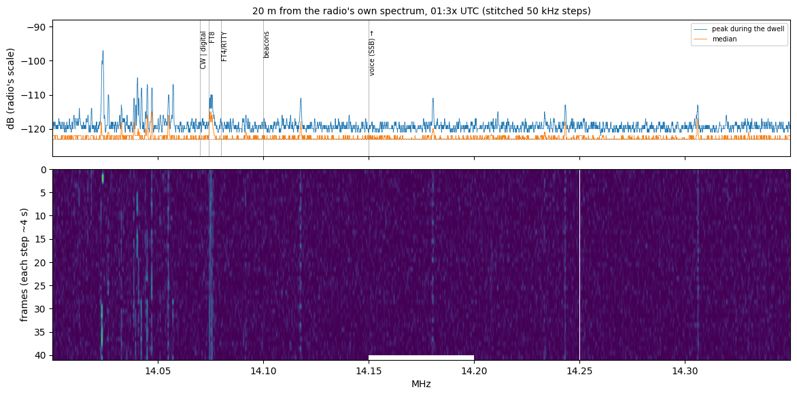
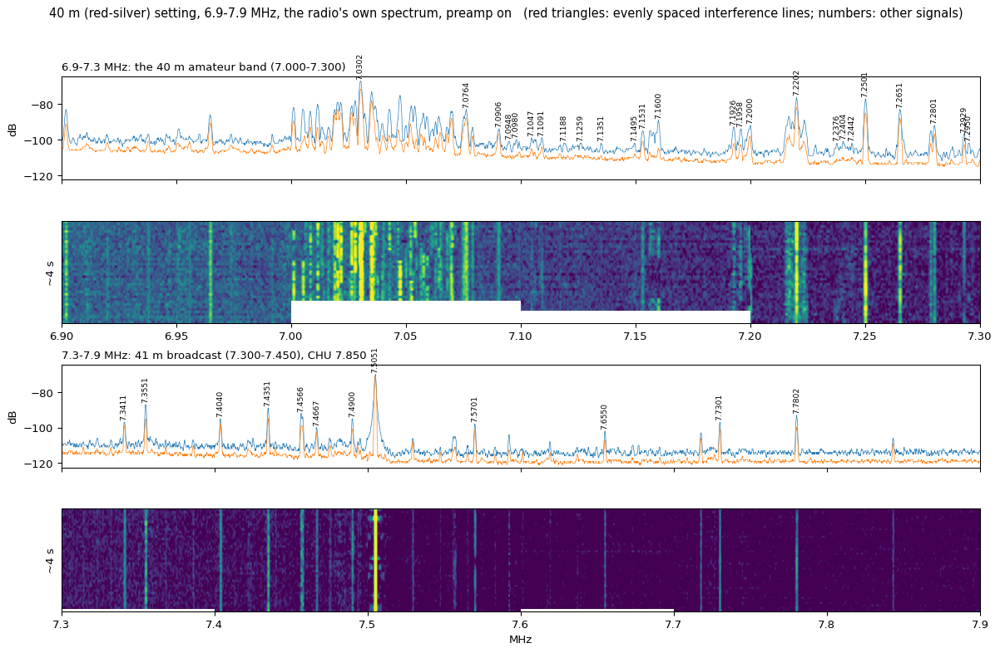
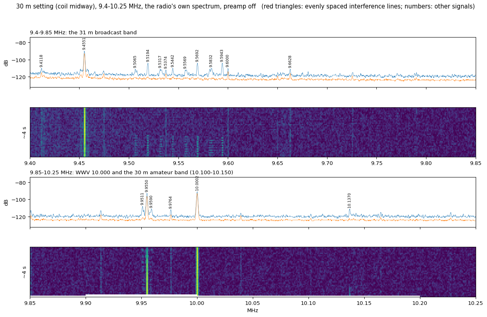

# JPC-12 on the Xiegu X6200: tuning and reception report

Dublin, Ohio (grid EN80kc). Night of 2026-11-07 to 2026-11-08, 23:50 to 04:28 UTC. Receive only: nothing was transmitted.

## 1. Setup

| Item | As used |
|---|---|
| Antenna | JPC-12 portable vertical, whip fully extended, 4 radials (one long), about 10 ft of coax, on a wooden swingset in a small suburban backyard |
| Radio | Xiegu X6200, OpenX6X00 v0.3.8 on the SD card, base firmware 1.0.7 |
| Control | Remotely over WiFi: the radio's TCI server (port 50001) and its paired remote session (port 50002), plus SSH for audio |
| Power | Internal battery, plus at times a 56 V battery pack with a 120 V inverter feeding Xiegu's mains adapter ("the charger") |
| Recording | The radio's receive audio, 12 kHz mono, captured over SSH regardless of the volume knob |

## 2. Coil settings and what each one covers

| Coil slider | Band it tunes | Evidence | Time used (UTC) |
|---|---|---|---|
| Red-gold mark, near the top of the coil | 20 m (14 MHz) | FT8 frequency sweep at about 23:55: 20 m busiest (S-meter swing 14 dB), 30 m 11 dB, 17 m and 15 m 5 dB, 40 m, 12 m, 10 m and 6 m flat | 23:50-02:34 |
| Red-silver mark, at the bottom of the coil | 40 m (7 MHz) | 40 m full of signals; 13-16 MHz signals fell to the noise | 02:38-04:18 |
| Midway between the two marks (set by eye) | 30 m (10 MHz) | WWV 10.000 MHz at +33 dB, 31 m broadcasters, 30 m FT8 | 04:19-04:28 |

- The gold mark is the JPC-12's approximate 20 m position; the silver mark is its 40 m position.
- The JPC-12 is made for 7-54 MHz. FM broadcast (88-108 MHz) still came in with the coil on red-silver, at reduced strength.
- Finding resonance from the S-meter does not work on this radio: its readings stop at -121 dBm, and the band noise at night never lifted it. A 7-30 MHz noise sweep came out flat. Signals seen on the radio's spectrum are the reliable guide.

## 3. How to tune: what worked

1. **Look first, then tune.** The radio's own spectrum, read in 100 kHz views (zoom 1), shows where stations are. Stepping by S-meter alone missed most of them.
2. **Choose the mode the signal uses:**
   - FT8, FT4, JS8, WSPR, PSK31, RTTY: USB with a 100-3100 Hz filter.
   - 40 m voice: LSB. Voice signals with a carrier (7.250 and 7.265 MHz) are AM: in LSB they carried a 1 kHz whistle (51 dB over the speech); in AM it was gone.
   - Shortwave broadcast, WWV, CHU, airband: AM. FM broadcast: wide FM.
   - CW: USB, tuned so the tone sits near 700 Hz.
3. **LSB voice:** zoom in (12.5 kHz view) and find where the signal's energy stops at the top; the dial goes about 300 Hz above that.
4. **Over TCI, send the frequency first, then the mode.** A band change brings back that band's saved mode and would undo a mode sent before it.
5. **Zoom is kept per mode, and the preamp per band.** After a band change, check both.
6. **Lock the dial when parked.** A bumped knob (500 Hz steps) and a scrolled browser mouse both moved the dial off frequency; the lock stops both, and also stops remote retuning until it is unlocked.
7. **FT8, FT4, JS8 and WSPR recordings must start on their slot boundaries** (15 s, 7.5 s, 15 s, even minute).

## 4. Receive settings measured

Measured at 14.074 MHz around 02:20 UTC, charger on, on the radio's spectrum and audio.

| Setting | Result | Kept |
|---|---|---|
| Preamp | Signal-to-noise unchanged; the spectrum's floor sat at -99 dB with it on and -115 dB with it off, further from the bottom of the display's scale | On |
| Noise blanker | No change in floor or interference lines. The noise was not impulsive (audio kurtosis about 0) | Off |
| RF gain 100 (from 63) | Signals and noise both up 18 dB; signal-to-noise unchanged | 63 |
| Attenuator | Weak signals 2-3 dB lower | Off |
| Noise reduction | Not tested; it distorts digital modes | Off |
| AGC | Not compared | Auto |

## 5. What was received

### 5.1 Coil on red-gold (20 m), 23:50-02:34 UTC

| Frequency | Mode | Time | Result |
|---|---|---|---|
| 14.074 MHz | FT8 | 23:58-02:34 | 3,030 messages, 242 stations, 32 countries. Average decodes per 15 s slot: 14.5 (23:xx), 13.7 (00:xx), 6.0 (01:xx), 3.9 (02:xx) |
| 14.0285 MHz | CW (Sweepstakes) | 01:01 | `W4IX NR 349 U K0SN 75 MT TU`, 30 WPM |
| 14.040-14.057 MHz | CW, tuned from the spectrum | 01:31-01:33 | N6RO and N6AR calling CQ SS; KL7SB (Alaska, `76 AK`); W6EU (`B W6EU 58 SV`). The strongest signal, 14.0239, sent in bursts and did not copy |
| 14.080 MHz | FT4 | 01:05 | `CQ XQ3SK FF46` (Chile) |
| 14.078 MHz | JS8 | 01:02, 01:22 | No JS8 on the air |
| 14.0695 MHz | PSK31 | 01:02 | One weak signal at 1377 Hz audio; no copy |
| 14.0825 MHz | RTTY | 01:05 | None |
| 14.230 MHz | SSTV | 01:07 | None in 60 s |
| 14.150-14.350 MHz | Voice | 01:06, 01:30 | No voice signals; only steady lines at 14.118, 14.180, 14.243 and 14.306 MHz |
| 14.0956 MHz | WSPR | 01:10 cycle | 0 spots |
| 14.100 MHz | NCDXF beacons | 01:12, 01:24 | None above the noise |
| 14.670 MHz | CHU | 01:08 | Not heard |
| 15.000 MHz | WWV | 01:08 | Not heard |
| 15.770 MHz | Shortwave broadcast (AM) | 01:09 | Weak; programme audio present |
| 540-1700 kHz | AM broadcast band | 23:53 | Strongest 1580 kHz (-96 dBm), then 1230, 820 and 610 kHz |
| 13.560 MHz | Pulsed signal (ISM band) | 02:14 | +33 dB, sending in bursts |

Farthest 20 m FT8 stations, from their grid squares: C91RU, Mozambique (13,790 km); D2UY, Angola (10,921 km); LU9XJR, Argentina (10,277 km). 9X5KM (Rwanda) and 9K2YM (Kuwait) were each decoded once.

### 5.2 Coil on red-silver (40 m), 02:38-04:18 UTC

Spectrum, 6.9-7.9 MHz at 02:40 (charger off):

- CW wall to wall at 7.000-7.065 MHz; strongest 7.0302 (+47 dB).
- FT8 and JS8 at 7.074-7.080 MHz (+31 dB). Digital signals at 7.09-7.11 MHz.
- Voice at 7.160, 7.193-7.200, 7.220, 7.250, 7.265, 7.280 and 7.293 MHz.
- Broadcasters at 7.341, 7.355, 7.404, 7.435, 7.457, 7.490, 7.505 (strongest), 7.570, 7.655, 7.730 and 7.780 MHz. Nothing at CHU 7.850.

| Frequency | Mode | Time | Result |
|---|---|---|---|
| 7.074 MHz | FT8 | 02:38-04:18 | 4,309 messages, 343 stations, 33 countries. Average decodes per slot: 17.6 (02:xx), 17.0 (03:xx), 15.9 (04:xx) |
| 7.0295 MHz | CW (Sweepstakes) | 02:42 | K5KU, noisy copy at 46 WPM |
| 7.040 MHz | CW (Sweepstakes) | 02:42 | `CQ SS W6PH W6PH`; part of an exchange from WA6KHK (`508 B`) |
| 7.0475 MHz | FT4 | 02:48 | `KM6TAU KQ4CRY R-10`, then `R-14` |
| 7.078 MHz | JS8 | 02:49 | `W6CJ: K1KFX HW CPY?`, `K1KFX: W6CJ HW CPY?`, `KF5NRU: W6CJ HEARTBEAT SNR -13` |
| 7.0386 MHz | WSPR | 02:50 cycle | 6 spots: K5NAV DM55 (-14 dB), N0KAM DN84 (-19), WW0WWV DN70 (-20), K7CMI DN57 (-20), KE7ZXJ CN95 (-21), AE0GQ DM79 (-23) |
| 7.2245 MHz | Voice, LSB | 02:43 | A clear voice contact |
| 7.160 MHz | Voice, LSB | 02:44 | Voice |
| 7.250, 7.265 MHz | Voice, AM | 02:55 | AM voice signals (first recorded in LSB with a 1 kHz whistle) |
| 7.505 MHz | Broadcast, AM | 02:45 | Strong, clear speech and music |
| 7.355, 7.490, 7.570 MHz | Broadcast, AM | 02:45-02:46 | Weaker programme audio |
| 7.850 MHz | CHU | 02:46 | Not heard |
| 7.0695 MHz | PSK31 | 02:47 | No real copy |
| 7.089 MHz | RTTY | 02:47 | No real copy |

Farthest 40 m FT8 stations: ZS1WC, South Africa (13,586 km); V51NA, Namibia (12,426 km); 4X1UF, Israel (9,739 km); SV5BYP, Dodecanese, SV3CKF, Greece, and LZ1SJ, Bulgaria (8,400-9,000 km).

### 5.3 Coil midway (30 m), 04:19-04:28 UTC

| Frequency | Mode | Time | Result |
|---|---|---|---|
| 9.4-9.85 MHz | 31 m broadcast | 04:19 (charger off) | Broadcasters; strongest 9.455 MHz (+34 dB) |
| 9.955 MHz | Broadcast | 04:19 | +31 dB |
| 10.000 MHz | WWV, AM | 04:2x | +33 dB steady carrier; 62 s recorded with a voice time announcement; S-meter -115 dBm median, -110 peak |
| 10.136 MHz | FT8 | 04:19-04:28 | 79 messages, 17 stations, 5 countries; 2.6 decodes per slot; farthest HC1HC, Ecuador (4,534 km) |

### 5.4 Above 55 MHz, coil on red-silver

| Range | Mode | Time | Result |
|---|---|---|---|
| 87.9-107.9 MHz, all 101 channels | Wide FM | 03:34 | About 15 stations. Strongest 92.3 MHz (+39 dB, -82 dBm), 97.9 (+31, -92), 103.9 (+29, -90), 107.9 (+29, -88), 104.9, 91.5, 94.7. The three strongest recorded: programme about 20 dB over the hiss |
| 118-137 MHz | AM airband | 03:36-03:46 | The strongest "channels" (122.825-122.975, peak +61 dB) are the radio's own 122.88 MHz clock spur. Next, 121.675 and 124.075 MHz (+40 dB): steady, no speech in 30 s. No aircraft voice captured |
| 137.1, 144.39, 145.80, 146.52, 146.76, 162.40, 162.55 MHz | Base tuned directly, NFM | 03:48-03:56 | Noise only (about -124 dBm): no APRS, no 2 m, no NOAA Weather Radio |
| 137.86, 141.86, 153.46 MHz | Base tuned directly, WFM | 03:55 | Mirror images of FM stations (107.9, 103.9, 92.3 MHz): 153.46 reads exactly as 92.3 does (-80 dBm). The X6200 samples at 122.88 MHz; above that it hears the mirror of what lies below |

## 6. Interference seen

- **Three evenly spaced combs across 13.4-15.9 MHz** at 02:14 UTC, charger on: 98.24 kHz spacing (25 lines, about +22 dB), about 102.9 kHz (23 lines, about +20 dB) and about 95.6 kHz (11 lines, about +9 dB). They were just as strong with the coil on 40 m, so they enter through the DC lead, not the antenna. Their exact frequencies drifted as the battery charged.
- **The 102.9 kHz comb is the charger's:** with it off, 6.9-7.9 MHz had no comb lines (02:37-02:40); plugged back in at 02:55, each 100 kHz view gained one steady +16-18 dB line, 102.9 kHz apart (6.9998, 7.4112, 7.6170, 7.8230 MHz).
- **Steady lines at 14.118, 14.180, 14.243 and 14.306 MHz** (01:30, before the charger was connected): carriers, not stations.
- **The radio's own 122.88 MHz clock**, a +59 dB carrier at 122.880 MHz.

## 7. Decoders used

| Mode | Decoder | Confirmed |
|---|---|---|
| FT8, FT4 | ft8_lib (kgoba, commit 9fec6ca) | Decodes on real signals |
| WSPR | The repository's wsprd | Decodes on real signals |
| JS8 | The radio's own JS8 receiver run offline (tools/js8_play) | A synthetic two-station band, and real signals |
| CW | Written that night | Decodes on real signals |
| PSK31, RTTY | Written that night | Synthetic test signals only; no real copy that night |

## 8. Where I fell short

**Antenna range**

- Three coil positions only: red-gold (20 m), red-silver (40 m) and midway (30 m). The 17 m, 15 m, 12 m, 10 m and 6 m taps were not tried.
- The 30 m position was set by eye. The planned fine-tuning, moving the slider a notch at a time against WWV's strength, was skipped because of condensation.
- The whip length was never changed. The quarter-wave arrangement for VHF (fewest coil turns, whip collapsed to about 60-75 cm) was not tried: FM and the airband were measured with the coil on 40 m.
- No resonance curve: the S-meter's -121 dBm floor made the noise sweep useless, and no SWR scan was run (receive only).
- 80 m and below are outside the JPC-12's range and were not tried. The AM broadcast band was checked only with the coil on red-gold.

**Receive settings**

- The settings were compared once, at one frequency (14.074 MHz), one time (02:20 UTC) and one power condition (charger on), and not repeated on 40 m or 30 m.
- Not tested: noise blanker level and width, noise reduction level, the auto notch, AGC slow, fast and off, and filter widths other than the defaults. RF gain was compared only at 63 and 100.
- The preamp is set per band, and was not checked after each coil move (on 30 m it was off).

**Reception**

- No aircraft voice (an overnight scan, mostly taken up by the radio's own clock spur).
- CHU (7.850 and 14.670 MHz) and WWV 15.000 MHz were not heard; WWV 10.000 MHz was.
- No real copy of PSK31, RTTY or SSTV, and no 20 m voice, JS8, WSPR or beacon reception. 20 m had largely closed after about 01:00 UTC.
- The charger-off check of the combs at 13-16 MHz was not completed: the radio was switched off a few seconds into it.
